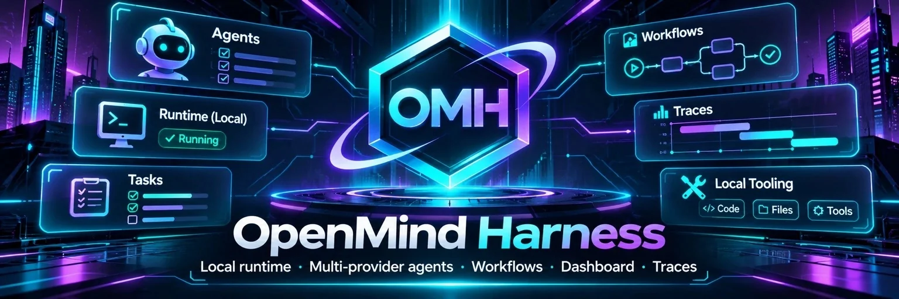

<p align="center">
  
</p>

<h1 align="center">OpenMind Harness</h1>

<p align="center"></p>

<p align="center">
  <strong>Local runtime · Multi-provider agents · Workflows · Dashboard · Traces</strong>
</p>

<p align="center">
  <a href="docs/omh-runtime.md">Runtime documentation</a> ·
  <a href="docs/features.md">Features</a> ·
  <a href="https://github.com/tjcrims0nx/openmind-harness/actions">Build status</a>
</p>

> OpenMind Harness is [OpenCode](https://opencode.ai) with a universal multi-provider config: one OpenAI-compatible interface that any provider plugs into. The configured default is Google Gemini (`google/gemini-3.5-flash-lite`, requiring a valid provider credential); the small-model fallback is an Experiential Labs DeepSeek route. It runs the same everywhere — iOS app, Linux server, macOS, Windows, Android/Termux — with the same providers, the same default, the same fallback. Only the shell differs. No server, no account, no subscription — the harness and your keys live on your machine.

**Reliability note (November 22, 2026):** The previous `google/gemini-3.8-flash` default was observed to hang for 120 and 180 seconds with no output, while `gemini-3.5-flash-lite` returned a response in approximately 6 seconds using the same key and setup. OMH now defaults to Flash Lite. The 3.8 model remains optional, not automatically selected. See [model troubleshooting and sandbox platform limits](docs/omh-runtime.md#model-reliability-and-host-isolation).

## The harness

OpenCode runs its standard agent loop (prompt → model → tools → execute → observe → repeat) with sessions, a config file, provider/model switching, and file and shell tools. OMH also includes experimental local runtime modules for tasks, workflows, memory, isolated execution, team workspaces and traces. They run through a separate CLI and are not yet integrated into the OpenCode UI. Full feature list: [docs/features.md](docs/features.md).

Two OpenCode server modes (the OMH iPad home additionally uses its own native UIKit runtime client):

- **`opencode web`** — the full web UI (default port **4097**). Linux/Termux setup scripts launch it; the iOS/iPadOS app embeds the OpenCode editor in a WKWebView. The separate OMH runtime dashboard is also available as a secondary web view on iPad.
- **`opencode serve`** — the API server only (default port **4096**), for headless use or driving it from another client.

Both bind `127.0.0.1` by default (this device only) and run with no password (`OPENCODE_SERVER_PASSWORD` is deliberately unset — the UI is only reachable from the device itself). To reach the UI from another device, set a password first and bind all interfaces: `OPENCODE_SERVER_PASSWORD='…' opencode web --hostname 0.0.0.0`. Never expose it without a password.


## Live Vercel dashboard + remote MCP (experimental)

The same neon dashboard can run as a **Vercel frontend connected to a real Linux OMH worker**, with an authenticated remote MCP endpoint and live task, schedule, plugin, and proposal controls. No demo state is substituted for the worker: unconfigured or unreachable Linux backends report offline. The Linux daemon, execution sandbox, and OpenCode sessions remain on a trusted Linux host; Vercel is the UI and protected API gateway. Setup, required secrets, tunnel guidance, transport tests, and limitations: **[Live Vercel + MCP connector guide](docs/vercel-live.md)**.

## OMH local runtime (experimental)

OMH now ships an independent Node.js CLI for persistent tasks, memory, manual skill publishing, scoped workspaces and snapshots, team mailboxes, tick-based schedules, opt-in tracing, and Linux bubblewrap sandbox execution. The sandbox refuses to run without Linux/bwrap and does not expose the host as a fallback. A **read-mostly MCP bridge** now exposes selected status, memory, trace, task-inspection and skill-proposal tools inside OpenCode after running `node scripts/install-omh-runtime.mjs`. Privileged execution remains in the separate CLI/daemon; this is not a full OpenCode UI integration. See [usage, security boundaries and limitations](docs/omh-runtime.md).

Run `node scripts/omh-dashboard.mjs` to open the locally hosted midnight-blue dashboard at `http://127.0.0.1:4177`. Its live controls can cancel queued tasks, retry failed read-only jobs, pause schedules, disable plugins and reject skill proposals; a separate opt-in administrator token enables approved governance actions without exposing arbitrary shell or agent execution. The daemon emits a monitored heartbeat, and the state stores serialize concurrent writes. The dashboard must remain bound to loopback, not exposed publicly.

Run `node scripts/omh-runtime.mjs status` or `node scripts/omh-runtime.mjs doctor` to check the runtime and sandbox prerequisites. Use `node scripts/install-omh-runtime.mjs` to install the OpenCode MCP bridge, or `node --test modules/*.test.mjs` for module tests. The queue now supports `task:cancel` for pending work and `task:retry` for explicitly retrying failed work (limited attempts); active jobs are not falsely reported as cancelled.

## Providers

Pick a provider in the web UI's model picker; add its key once per machine (see "Adding keys" below). Keys are never stored in the repo or the config file — they are read from environment variables, the web UI's `/connect` flow, or `opencode auth login`.

| Provider | Model | Key env var | Notes |
|---|---|---|---|
| OpenAI | `openai/gpt-5` | ChatGPT Plus/Pro OAuth or `OPENAI_API_KEY` | Optional provider. ChatGPT models. With a Plus/Pro subscription, sign in via OAuth — no API credits needed. API-key use needs credits — an account with no credits returns `credit_balance_exhausted`. |
| Experiential Labs | `experientiallabs/deepseek-v4.1-flash:free` | `EXPLABS_API_KEY` | Free stock route; works out of the box as the fallback when OpenAI has no credits. |
| DeepSeek | catalog (`deepseek-flash`, `deepseek-v4-pro`, …) | `DEEPSEEK_API_KEY` | Stock DeepSeek API models. |
| Gemini | `gemini-3.5-flash-lite` (default), `gemini-3.8-flash` (optional) | `GEMINI_API_KEY` | Default changed to Flash Lite after repeated 3.8 Flash hangs (120–180 seconds with no output); Flash Lite responded in ~6 seconds on the affected setup. Validate both on your own key before selecting 3.8. |
| Anthropic | catalog (`claude-sonnet-5`, `claude-haiku-5-5`, …) | `ANTHROPIC_API_KEY` | Claude models. |
| Groq | catalog (`openai/gpt-oss-120b`, …) | `GROQ_API_KEY` | Fast hosted models. |
| Mistral | catalog (`codestral-2508`, …) | `MISTRAL_API_KEY` | Mistral models. |
| xAI | catalog (`grok-4.6`, …) | `XAI_API_KEY` | Grok models. |
| Together | catalog (empty in 1.19.6 — see note) | `TOGETHER_API_KEY` | The 1.19.6 model catalog lists no Together models yet; the provider is configured and the picker shows models once the catalog updates or a `models` entry is added. |
| OrcaRouter | `orcarouter/z-ai/glm-5.3-flash-free` | `ORCAROUTER_API_KEY` | Free model, verified live. |
| OpenRouter | catalog (`nvidia/nemotron-3-nano-omni-30b-a3b-reasoning:free`, …) | `OPENROUTER_API_KEY` | OpenRouter's free models. |
| Antigravity | `antigravity/gemini-3-flash` | Google account OAuth (`openmind-antigravity-login`) | Google's agentic models (Gemini, Claude) through your Google account — no API key. Needs the loopback bridge (starts automatically in the iOS app; start it by hand on Linux/Termux). |
| APInex | pinned free (`free/deepseek-v4.1-flash`, `free/glm-5.3-flash`, `free/gemini-3.8-flash`, `free/gpt-6-luna`, `free/claude-sonnet-4.6`) | `APINEX_API_KEY` | Gateway: Claude, GPT, Gemini, DeepSeek, GLM, Qwen, Kimi, Grok on one key (22 free models listed live). **Needs a one-time $5 top-up to unlock the free tier** — until then every model call returns a billing error ("Make a single top-up of $5 or more to unlock 25M free tokens daily for life"). The key itself works (the model list answers); the account just has no usable free tokens yet. |
| Pollinations | `pollinations/gpt-oss-20b` | none (keyless) | Free, no signup, no key. One model (GPT-OSS 20B). **Direct endpoint verified live (answers), but the harness run stalls** — OpenCode produces no output and the call never starts, twice in a row. Not reliable as a harness provider; kept as a spare. Rate-limited to about one request per 45 seconds per IP. |
| GitHub Models | pinned (`openai/gpt-4.1`, `deepseek/DeepSeek-R1`, `meta/Meta-Llama-3.3-70B-Instruct`) | `GITHUB_TOKEN` (a GitHub personal access token) | Free for any GitHub user — no card. One endpoint, many model families (GPT, DeepSeek, Llama, Mistral, Phi). Needs a PAT; not yet tested live. |
| Ollama | local server discovery | none | Local models at `http://localhost:11434/v1`. |
| LM Studio | local server discovery | none | Local models at `http://localhost:1234/v1`. |
| Custom endpoint | your models | `OPENMIND_CUSTOM_BASE_URL` + `OPENMIND_CUSTOM_API_KEY` | Any OpenAI-compatible endpoint you supply. Set it with `openmind-set-custom-endpoint` (or `/custom-endpoint` in the web UI) — it asks for the URL, the bearer key and a model id, and saves them where the harness reads them. |

The default model is `google/gemini-3.5-flash-lite` (top-level `"model"` in [`opencode.json`](opencode.json), also used by the planner, implementer, tester, and reviewer). The `small_model` and `fast` agent use `experientiallabs/deepseek-v4.1-flash:free` if you have credentials for that service; OpenCode does not automatically fail over from a stalled main model just because `small_model` is configured. To update an existing installation, copy the latest `opencode.json` to your OpenCode configuration directory or rerun the platform setup, and start a **new session**. Check the current model in the picker; existing sessions may retain the previous selection.

## ChatGPT Plus — GPT-5 with no API credits

The default is GPT-5 because it works on a **ChatGPT Plus/Pro subscription** — no API credits needed. OpenCode's built-in OpenAI login signs in with your ChatGPT account over OAuth; requests then count against the subscription, not against API billing. (An OpenAI API key works too — export `OPENAI_API_KEY` — but with Plus you do not need one, and the config deliberately sets no API key for the OpenAI provider so the subscription login is used.)

```sh
opencode auth login --provider openai
```

Pick a method (verified in OpenCode 1.19.6):

| Method | How it works | Where to use it |
|---|---|---|
| `ChatGPT Pro/Plus (browser)` | Opens a browser; sign-in completes through a `localhost:1455` callback. | Linux, Termux (the phone browser shares Termux's localhost). |
| `ChatGPT Pro/Plus (headless)` | Device code — a short code to enter at `auth.openai.com/codex/device`. No browser needed where OpenCode runs. | **iPad guest (use this one)**, SSH, containers. |
| `Manually enter API Key` | API-key login (API billing, not the subscription). | Only if you want API billing instead of Plus. |

Login state is stored in `~/.local/share/opencode/auth.json` (mode `0600`).

**On the iPad**, use the app's Terminal (`>_` in the control bar) — the browser callback cannot reach the guest's loopback from iPad Safari, so the in-app web UI's `/connect` browser flow does not work for ChatGPT there. In the guest terminal run:

```sh
opencode auth login --provider openai --method "ChatGPT Pro/Plus (headless)"
```

Enter the shown code at `auth.openai.com/codex/device` in Safari. If the headless sign-in is refused by OpenAI's security checks, the reliable alternative is to sign in once on Linux or Termux (browser flow) and copy `~/.local/share/opencode/auth.json` into the guest at `/root/.local/share/opencode/auth.json` — same file, same login. Never paste the file's contents into chat; copy the file itself.

## Antigravity — Google account sign-in

Antigravity is Google's agentic platform (Cloud Code Assist): Gemini and Claude models through Google's Cloud infrastructure, billed against your Google account — no API key. The harness speaks to it through a small loopback bridge (`scripts/antigravity-bridge.mjs`), because Antigravity's API is its own format, not OpenAI-compatible. The bridge translates the harness's requests and back; it only ever runs on `127.0.0.1` on your own machine.

```sh
openmind-antigravity-login
```

Sign in with your Google account in the browser that opens (or with `--manual` on the iPad guest Terminal and headless machines: the script prints the sign-in URL, you paste back the redirect URL). Tokens are stored at `~/.config/opencode/antigravity-auth.json` (mode `0600`) — access token, refresh token, your email, and the Google Cloud project id the API needs. The bridge refreshes the token itself when it expires.

Start the bridge (the iOS app starts it automatically when the guest boots):

```sh
node ~/.local/bin/openmind-antigravity-bridge.mjs
```

Then pick `antigravity/gemini-3-flash` in the model picker. If you are not signed in, the model answers with a clear "not signed in" error — run the login script. Check sign-in state any time with `openmind-antigravity-login --status`, and refresh the token with `--refresh`. The `ANTIGRAVITY_API_KEY` env var in the config is only the loopback bridge's key — the real credential is the OAuth token file, never a key in the config.

## Onboarding — first run

1. Install on your platform (below).
2. Connect a provider: `opencode auth login --provider openai` (ChatGPT Plus/Pro) or export the provider's key (`EXPLABS_API_KEY`, …).
3. Test the connection: `opencode run --model experientiallabs/deepseek-v4.1-flash:free "Say only ok."` — a one-line answer proves the provider, the key, and the model ID all work.
4. Open the web UI (`opencode web`, http://127.0.0.1:4097) and pick a model. That is the whole setup; there is no account and no signup.

## Portable harness runtime packages (experimental)

[Portable packages CI](https://github.com/tjcrims0nx/openmind-harness/actions/workflows/portable-packages.yml) creates downloadable artifacts for **Linux x64**, **macOS Apple Silicon**, **Windows x64**, and **Termux aarch64 scripts**. These packages contain the OMH Node.js runtime modules, local dashboard assets, configuration, and platform-specific command launchers. They **are not self-contained native executables**: install Node.js **22+** separately. They do not bundle OpenCode, provider credentials, or any paid API access.

On Linux, macOS or Termux, unpack an artifact and run `sh bin/omh status` or `sh bin/omh-dashboard` from its extracted package folder. On Windows, run `bin\\omh.cmd status` or `bin\\omh-dashboard.cmd` from Command Prompt. The runtime stores state in the current workspace unless `OMH_WORKSPACE` or `OMH_STATE_DIR` is set. Run only within a trusted workspace. The dashboard binds loopback.

CI runs a **clean temporary-workspace smoke test** and checks runtime status/diagnostics and host-compatible launchers before artifacts upload. The Termux archive is assembled on Linux and is **not a verified Android device binary**. End-to-end OpenCode model calls, provider logins, physical devices, and kernel isolation require separate tests. See [the workflow](https://github.com/tjcrims0nx/openmind-harness/actions/workflows/portable-packages.yml) for current success/failure and download links; only use an artifact after its relevant job passes.

For a full OpenCode installation, use the platform setup scripts below
(Linux, macOS, Windows, Termux), which handle the platform-specific engine
installation. Portable OMH runtime packages supplement these rather than
replace them. One-line install commands for every platform: [INSTALL.md](INSTALL.md).

## Platforms — the same harness, every shell

| Platform | Shell | Setup |
|---|---|---|
| **iOS / iPadOS** | iPad: native UIKit sidebar/detail workspace; iPhone: native shell with WebKit dashboard; both have embedded OpenCode editor | Separate app repository: [omh-iOS](https://github.com/tjcrims0nx/omh-iOS). Native iPad work is under [PR #4](https://github.com/tjcrims0nx/omh-iOS/pull/4), pending exact-commit simulator and device verification. GitHub Actions publishes an unsigned IPA that requires signing. |
| **Linux** (Cosyra container, Oracle VM, any server) | Terminal / server | `bash linux-setup.sh` — installs the official Linux binary (1.19.6) to `~/.local/bin`, installs the config + skill + guard plugin, launches `opencode web` on http://127.0.0.1:4097. Falls back to `npm i -g opencode-ai` if the download fails. |
| **macOS** (Apple Silicon or Intel) | Terminal | `bash macos-setup.sh` — installs the official macOS binary (1.19.6) to `~/.local/bin`, clears the Gatekeeper quarantine flag, installs the config + skill + guard plugin, launches `opencode web` on http://127.0.0.1:4097. Node.js 22+ is installed on demand (Homebrew, else the official tarball) for the OMH runtime/MCP bridge. |
| **Windows** (PowerShell, x64 or ARM64) | PowerShell | `.\windows-setup.ps1` — installs the official Windows binary (1.19.6) to `%LOCALAPPDATA%\Programs\opencode`, adds it to your user PATH, installs the config + skill + guard plugin, launches `opencode web` on http://127.0.0.1:4097. Node.js 22+ is installed on demand (winget, else the official zip) for the OMH runtime/MCP bridge. |
| **Android** (Termux) | Termux on the phone | `bash termux-setup.sh` — installs the native Android OpenCode build (guysoft/opencode-termux, 1.17.9 — see version note), installs the config + skill + guard plugin, launches `opencode web` on http://127.0.0.1:4097 (open it in the phone browser). No separate Android app. |

### Version notes

- iOS guest, Linux, macOS and Windows run OpenCode **1.19.6** (same release).
- Termux runs OpenCode **1.17.9** (guysoft/opencode-termux v0.2.1, the latest Android release as of 2026-11-21) — upstream publishes no Android binary, and its Linux glibc binary cannot run under Android's Bionic libc. Same config, slightly older engine. For the exact 1.19.6 build on the phone, use proot instead: `pkg install proot-distro && proot-distro install ubuntu`, then run `linux-setup.sh` inside the Ubuntu container.

### One config, everywhere

`opencode.json` is the single source of truth. The iOS guest image is built from this exact file (the [omh-iOS](https://github.com/tjcrims0nx/omh-iOS) build fetches it from this repo), and all four setup scripts install this exact file to the platform config folder (`~/.config/opencode/` on Linux/macOS/Termux, `%USERPROFILE%\.config\opencode\` on Windows). Edit it in one place and every platform picks it up on its next install or rebuild. No per-platform config differences: same providers, same model IDs, same defaults, same agents.

## Adding keys

Keys go in the machine, not in the repo. Three ways:

1. **ChatGPT Plus/Pro** — `opencode auth login --provider openai` (see above).
2. **Web UI** — open the model picker in the OpenCode UI and connect a provider there (the `/connect` flow).
3. **Environment** — export the variable in your shell, e.g. `export EXPLABS_API_KEY=…`, or in the iOS app's Terminal (`>_` in the control bar) in the guest shell, then restart the server from the `⋯` menu.

## The iOS app

The iOS/iPadOS app is a separate packaging of this harness: a native UIKit shell running an iSH-ARM64 / Alpine guest, with the embedded OpenCode editor and a loopback OMH runtime dashboard. **On the current development branch**, iPadOS launches a native UIKit sidebar/detail workspace that reads the OMH dashboard's `/api/state` endpoint; the browser-based dashboard remains available as a secondary screen. iPhone keeps a different, WebKit-first home. The app lives in [tjcrims0nx/omh-iOS](https://github.com/tjcrims0nx/omh-iOS), with [iPad workspace documentation](https://github.com/tjcrims0nx/omh-iOS/blob/rebrand/omh/docs/IPAD_WORKSPACE.md), [build and verification guidance](https://github.com/tjcrims0nx/omh-iOS/blob/rebrand/omh/docs/BUILD_AND_VERIFY.md), and [PR #4](https://github.com/tjcrims0nx/omh-iOS/pull/4). The build fetches a **pinned revision** of this harness; changes here reach the app only when that pin is updated and the guest/IPA is rebuilt. An unsigned IPA needs signing, and green compilation alone does not verify a simulator launch, working runtime or physical iPad installation.

## Eval

`eval/` holds a small task set (breadth tasks plus an exec-verified hard subset) and a runner that grades by running the model's actual artifact, so a stub fails. `bash eval/run.sh`. A live run needs a signed-in provider or a key. See `eval/README.md`.

## License

OpenMind Harness is licensed under the **GNU General Public License v3.0** (see [LICENSE](LICENSE)), because it compiles and statically links the [iSH](https://github.com/ish-app/ish) / [iSH-ARM64](https://github.com/OpenMinis/ish-arm64) emulator, which is GPLv3 with the additional App Store terms in [`LICENSE.IOS`](https://github.com/tjcrims0nx/omh-iOS/blob/main/ish-arm64/LICENSE.IOS) (in the omh-iOS repo). Those additional terms apply to OpenMind Harness as well. See [LICENSE.md](LICENSE.md) for the third-party component list.

## Experimental OMH modules

The independent [Smart Router policy engine](modules/smart-router.mjs) supports manual, balanced, budget and quality selection, filtered failover, and cost/budget calculations. Run its tests with `node --test modules/smart-router.test.mjs`. **It is not wired into the live OpenCode provider pipeline yet**; it does not discover provider health or prices, and no automatic routing or cost enforcement should be assumed. See [the unified agent roadmap](docs/omh-unified-agent-roadmap.md) for the remaining work.
