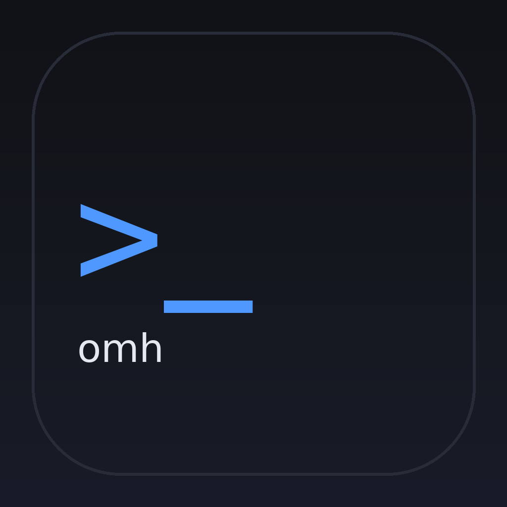

<p align="center">
  <br>
  <strong>OpenMind Harness</strong><br>
  A universal coding-agent harness for iPhone and iPad — OpenCode running in an on-device Linux guest.
</p>

> OpenMind Harness is a native iOS app that runs [OpenCode](https://opencode.ai) inside an Alpine Linux guest (iSH-ARM64 emulator) and shows its web UI in a WKWebView. One universal OpenAI-compatible API interface: point it at any provider below and switch between them from the web UI's model picker. No server, no account, no subscription — the harness and your keys live on your device.

## Providers

OpenCode is configured with a multi-provider setup. Pick a provider in the web UI's model picker; add its key once the app is running (see "Adding keys" below). Keys are never stored in the repo or the config file — they are read from environment variables in the guest.

| Provider | Model | Key env var | Notes |
|---|---|---|---|
| OpenAI | `openai/gpt-5` | `OPENAI_API_KEY` | **Default.** ChatGPT models. Your OpenAI account needs credits — an account with no credits returns `credit_balance_exhausted`. |
| Experiential Labs | `experientiallabs/deepseek-v4.1-flash:free` | `EXPLABS_API_KEY` | Free stock route; works out of the box as the fallback when OpenAI has no credits. |
| DeepSeek | catalog (`deepseek-flash`, `deepseek-v4-pro`, …) | `DEEPSEEK_API_KEY` | Stock DeepSeek API models. |
| Gemini | catalog (`gemini-2.5-flash`, `gemini-3.5-flash-lite`, …) | `GEMINI_API_KEY` | Google provider. |
| OrcaRouter | `orcarouter/z-ai/glm-5.3-flash-free` | `ORCAROUTER_API_KEY` | Free model, verified live. |
| OpenRouter | catalog (`nvidia/nemotron-3-nano-omni-30b-a3b-reasoning:free`, …) | `OPENROUTER_API_KEY` | OpenRouter's free models. |

The default model is `openai/gpt-5` (top-level `"model"` in [`cross-platform/opencode.json`](cross-platform/opencode.json) — the same config file used on Linux and Termux). If OpenAI has no credits, switch to `experientiallabs/deepseek-v4.1-flash:free` in the model picker — that is the working out-of-the-box fallback.

## ChatGPT Plus — GPT-5 with no API credits

The default is GPT-5 because it works on a **ChatGPT Plus/Pro subscription**
— no API credits needed. OpenCode's built-in OpenAI login signs in with your
ChatGPT account over OAuth; requests then count against the subscription, not
against API billing. (An OpenAI API key works too — export `OPENAI_API_KEY` —
but with Plus you do not need one, and the config deliberately sets no API
key for the OpenAI provider so the subscription login is used.)

```sh
opencode auth login --provider openai
```

Pick a method (verified in OpenCode 1.19.6):

| Method | How it works | Where to use it |
|---|---|---|
| `ChatGPT Pro/Plus (browser)` | Opens a browser; sign-in completes through a `localhost:1455` callback. | Linux, Termux (the phone browser shares Termux's localhost). |
| `ChatGPT Pro/Plus (headless)` | Device code — a short code to enter at `auth.openai.com/codex/device`. No browser needed where OpenCode runs. | **iPad guest (use this one)**, SSH, containers. |
| `Manually enter API Key` | API-key login (API billing, not the subscription). | Only if you want API billing instead of Plus. |

Login state is stored in `~/.local/share/opencode/auth.json` (mode `0600`).

**On the iPad**, use the app's Terminal (`>_` in the control bar) — the
browser callback cannot reach the guest's loopback from iPad Safari, so the
in-app web UI's `/connect` browser flow does not work for ChatGPT there.
In the guest terminal run:

```sh
opencode auth login --provider openai --method "ChatGPT Pro/Plus (headless)"
```

Enter the shown code at `auth.openai.com/codex/device` in Safari. If the
headless sign-in is refused by OpenAI's security checks, the reliable
alternative is to sign in once on Linux or Termux (browser flow) and copy
`~/.local/share/opencode/auth.json` into the guest at
`/root/.local/share/opencode/auth.json` — same file, same login. Never paste
the file's contents into chat; copy the file itself.

## Use it everywhere

The harness is the same everywhere — same OpenCode, same providers, same
ChatGPT-primary default, same free DeepSeek fallback. Only the shell differs.
OpenCode runs its standard agent loop (prompt → model → tools → execute →
observe → repeat) with sessions and the model picker; nothing about the agent
itself is customized. See [cross-platform/README.md](cross-platform/README.md).

| Platform | How to run |
|---|---|
| **iOS / iPadOS** | This app — sideload the unsigned IPA (sign it yourself); it boots the guest and loads the web UI. |
| **Linux** (Cosyra container, Oracle VM, any server) | `bash cross-platform/linux-setup.sh` — installs Node 22 + `opencode-ai`, installs the config, launches `opencode web` on http://127.0.0.1:4097. |
| **Android** (Termux) | `bash cross-platform/termux-setup.sh` — installs the native Android OpenCode build (guysoft/opencode-termux, 1.17.9 — see version note), installs the config + skill, launches `opencode web` on http://127.0.0.1:4097 (open it in the phone browser). No separate Android app. |

Skills, task-routed agents, and how this harness compares to Hermes,
OrcaRouter, and dsh: [docs/harness-analysis.md](docs/harness-analysis.md).

## Adding keys

Keys go in the guest, not in the repo. Two ways:

1. **Web UI** — open the model picker in the OpenCode UI and connect a provider there (the `/connect` flow).
2. **Guest environment** — in the app's Terminal (`>_` in the control bar), set the variable in the guest shell, e.g. `export OPENAI_API_KEY=sk-…`, then restart the server from the `⋯` menu. The variable is read from the guest environment by `opencode-serve` on startup.

## How it works

```
┌─ OpenMind Harness ───────────────────────────────────────────────────┐
│  RootViewController ──► WKWebView ──► http://127.0.0.1:<port>        │
│  Harness supervisor (port pick · readiness probe · restart · health)  │
│  ┌────────────────────────────────────────────────────────────────┐  │
│  │  iSH-ARM64 emulator ──► Alpine 3.21 guest                      │  │
│  │    /usr/local/bin/opencode-serve                               │  │
│  │      → opencode serve --hostname 127.0.0.1 --port $DSH_PORT    │  │
│  └────────────────────────────────────────────────────────────────┘  │
└──────────────────────────────────────────────────────────────────────┘
```

- **The app** picks a free loopback port, launches `opencode-serve` in the guest, probes the server until it answers (ready when the HTTP status is < 500), and loads the OpenCode web UI in the WKWebView. The server is loopback-only and runs with no password (`OPENCODE_SERVER_PASSWORD` is deliberately unset — the UI is only reachable from inside the app).
- **The guest** is Alpine 3.21 arm64 with OpenCode 1.19.6 (musl arm64 binary, no Node needed). Your workspace lives in `/root/workspace` in the guest; session data in `/root/.config/opencode`.
- **iPad:** the app is universal (iPhone + iPad, all four iPad orientations) and behaves the same on iPad as on iPhone — same boot flow, same guest, same web UI.

## Install

The unsigned IPA is built by GitHub Actions (`.github/workflows/build-ipa.yml`, `CODE_SIGNING_ALLOWED=NO`). Sign it with your own Apple ID / developer certificate and sideload it (AltStore, Sideloadly, or Xcode) — no signing material is shipped in the repo.

## Build it yourself

```sh
git clone https://github.com/tjcrims0nx/openmind-harness-ios.git && cd openmind-harness-ios
make rootfs          # build/root.tar.gz — Alpine + OpenCode (~85 MB, ~6 min, needs network)
open DSH.xcodeproj   # DSH scheme → your iPad → set the team → Run
```

`make test` runs the emulator, rootfs, and simulator test suites. The guest image is built reproducibly by `scripts/build-rootfs.sh` from the Alpine 3.21 aarch64 repositories and the pinned OpenCode release.

## License

OpenMind Harness is licensed under the **GNU General Public License v3.0** (see [LICENSE](LICENSE)), because it compiles and statically links the [iSH](https://github.com/ish-app/ish) / [iSH-ARM64](https://github.com/OpenMinis/ish-arm64) emulator, which is GPLv3 with the additional App Store terms in [`ish-arm64/LICENSE.IOS`](ish-arm64/LICENSE.IOS). Those additional terms apply to OpenMind Harness as well. See [LICENSE.md](LICENSE.md) for the third-party component list.
