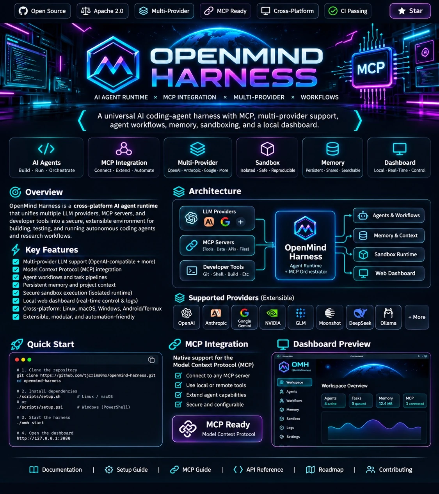

<p align="center">
  
</p>

<h1 align="center">OpenMind Harness</h1>
<p align="center"><strong>One workspace. Your models. Your agents. Your tools.</strong></p>
<p align="center"><sub>Local-first AI orchestration • Multi-provider • MCP • Workflows • Experimental native iPad client</sub></p>

<p align="center">
  <a href="https://github.com/tjcrims0nx/openmind-harness/actions/workflows/omh-modules.yml"></a>
  <a href="https://github.com/tjcrims0nx/openmind-harness/actions/workflows/portable-packages.yml"></a>
  <a href="LICENSE"></a>
  
</p>

<p align="center"><sub>
<a href="#-overview">Overview</a> ·
<a href="#-quick-start">Install</a> ·
<a href="#-providers">Providers</a> ·
<a href="#-mcp--plugins">MCP</a> ·
<a href="#-jailbreak-lab">Jailbreak Lab</a> ·
<a href="#-docs--links">Docs</a>
</sub></p>

---

### ⚡ Overview

**OMH** brings together [OpenCode](https://opencode.ai), configurable model providers, an independent Node.js orchestration runtime, a scoped MCP bridge and a local dashboard.

- 🤖 **Agents** — configured planner, implementer, tester, reviewer and fast roles.
- 🌐 **Models** — hosted, gateway, local and custom provider configurations.
- 🔌 **MCP** — approved tools for tasks, memory, diagnostics, traces and skills.
- 🧠 **Runtime** — local task queue, workflows, schedules, mailboxes and scoped memory.
- 📊 **Dashboard** — local activity and observed state at `127.0.0.1:4177`.
- 🛡️ **Controls** — schema validation, scoped permissions, reviewed changes and platform-dependent sandbox checks.

<sub>OpenCode handles its own model conversations and native tool loop. OMH's separate orchestration modules are experimental; they are not all wired into OpenCode's standard execution loop.</sub>

### 🚀 Quick start

**Choose your platform** ([full installation guide](INSTALL.md)).

<details open>
<summary>🐧 Linux</summary>

```bash
git clone https://github.com/tjcrims0nx/openmind-harness.git
cd openmind-harness
bash linux-setup.sh --no-launch
opencode auth login
opencode web
```
</details>

<details>
<summary>🍎 macOS</summary>

```bash
git clone https://github.com/tjcrims0nx/openmind-harness.git
cd openmind-harness
bash macos-setup.sh --no-launch
opencode auth login
opencode web
```
</details>

<details>
<summary>🪟 Windows · PowerShell</summary>

```powershell
git clone https://github.com/tjcrims0nx/openmind-harness.git
cd openmind-harness
.\windows-setup.ps1 -NoLaunch
opencode auth login
opencode web
```
</details>

<details>
<summary>🤖 Android · Termux</summary>

```bash
pkg update && pkg install -y git curl
git clone https://github.com/tjcrims0nx/openmind-harness.git
bash openmind-harness/termux-setup.sh --no-launch
opencode auth login
opencode web
```
</details>

**OpenCode UI:** `http://127.0.0.1:4097` · Connect a provider when you are ready. No particular hosted provider is required to be the default for your installation.

**OMH local runtime** (Node.js 22+):

```bash
node scripts/omh-runtime.mjs doctor
node scripts/omh-runtime.mjs status
node scripts/omh-dashboard.mjs
```

**OMH dashboard:** `http://127.0.0.1:4177` · Local state normally lives in `.omh/`. See [runtime docs](docs/omh-runtime.md).

### 🌐 Providers

Use the providers supported by your OpenCode installation and the settings in [`opencode.json`](opencode.json).

| 🔑 Hosted | 🔀 Gateways | 💻 Local |
| --- | --- | --- |
| OpenAI, Anthropic, Gemini, DeepSeek | OpenRouter, OrcaRouter, APInex, Experiential Labs | Ollama, LM Studio |
| GLM / Z.AI, Moonshot / Kimi, Qwen | GitHub Models and custom compatible endpoints | Your local models |
| Groq, Mistral, xAI, Together | User-defined API URL + key | No cloud key needed for local-only use |

The committed config currently names `google/gemini-3.5-flash-lite` as its default and `experientiallabs/deepseek-v4.1-flash:free` as its small model. **Configured does not mean authenticated, available or tested**; the small-model setting is not automatic failover.

```bash
opencode auth login
# Once connected, choose a supported model in OpenCode.
```

<sub>Keep credentials out of Git and logs. Provider availability and billing depend on each service.</sub>

### 🔌 MCP & plugins

Register OMH's local MCP bridge:

```bash
node scripts/install-omh-runtime.mjs
node scripts/install-omh-runtime.mjs --check
```

**Built-in scoped tool groups:**
`omh_status` · `omh_doctor` · `omh_memory_search` · `omh_task_list` · `omh_trace_recent` · `omh_agent_inbox` · skill proposals and bounded queue operations.

OMH MCP does **not** grant an unrestricted shell, automatic approvals or arbitrary filesystem access. Additional MCP connectors are configured separately. [MCP guide](docs/omh-runtime.md) · [Vercel integration](docs/vercel-live.md).

### 🧪 Jailbreak Lab

**Goal: the full [OpenMind Jailbreak Lab](https://github.com/tjcrims0nx/OpenMind-Jailbreak-Lab) inside OMH.** The Lab stays the underlying execution engine; the OMH integration is being developed in **[PR #6](https://github.com/tjcrims0nx/openmind-harness/pull/6)**.

| Component | Progress |
| --- | --- |
| 📈 Evidence summaries, comparisons, pending reviews | Read-only MCP bridge in PR |
| ▶️ Native Lab case runner and bounded campaigns | Initial opt-in execution bridge in PR |
| 🧬 Mutation, replay, guard evaluation and provenance | Integration pending |
| 👥 Human adjudication, exports and campaign history | Integration pending |
| 🖥️ Unified dashboard and iPad operation | Integration pending |

**Execution is not yet verified end to end.** The evidence fixture tests passed 3/3, but the Lab CLI requires its real SQLite schema (including `started_at`); the simplified evidence fixture cannot validate run creation. Live provider calls require explicit operator opt-in, approved inputs and bounded budgets. See [PR details](https://github.com/tjcrims0nx/openmind-harness/pull/6).

### 🛡️ Security & verification

- 🔒 Local interfaces bind to loopback by default; use authentication and network controls for any remote exposure.
- 🧱 Linux Bubblewrap availability **does not prove** sandbox execution. Unsupported isolation must fail closed.
- ✅ Run `node --test modules/*.test.mjs` and check the actual CI commit before trusting a release.
- 🧾 Review outputs and privileged actions explicitly; configured agents and providers are not automatically running.

### 📚 Docs & links

| | |
| --- | --- |
| 📦 [Installation](INSTALL.md) | 🛠️ [Features](docs/features.md) |
| ⚙️ [Runtime & MCP](docs/omh-runtime.md) | 🔗 [Remote / Vercel](docs/vercel-live.md) |
| 🗺️ [Roadmap](docs/omh-unified-agent-roadmap.md) | 🧪 [Evaluations](eval/README.md) |
| 🏗️ [Harness CI](https://github.com/tjcrims0nx/openmind-harness/actions) | 📱 [iOS CI](https://github.com/tjcrims0nx/omh-iOS/actions) |
| 📄 [License](LICENSE) | 📋 [Notices](LICENSE.md) |

---

<p align="center"><sub><strong>OPENMIND HARNESS</strong> · Local-first · Multi-provider · MCP-ready<br>GPL-3.0 · Build and runtime capabilities should be verified on the target platform.</sub></p>
